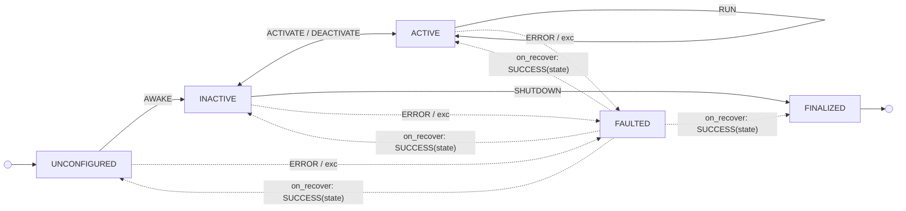

`LifecycleRunner` accepts an optional `event_sink` for lifecycle and target-state
events. Events are emitted synchronously on the calling thread, so sinks must
return quickly and must not block lifecycle work. Sink exceptions are logged and
do not interrupt the runner. Use `NullEventSink` (the default),
`StdlibLoggingSink`, or `FanOutEventSink` to select how events are consumed.