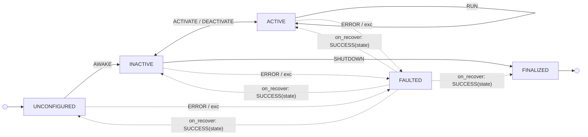

`LifecycleRunner` accepts an optional `event_sink` for lifecycle and target-state
events. Events are dispatched asynchronously; a full event queue drops new events
rather than delaying lifecycle work. Use `NullEventSink` (the default),
`StdlibLoggingSink`, or `FanOutEventSink` to select how events are consumed.